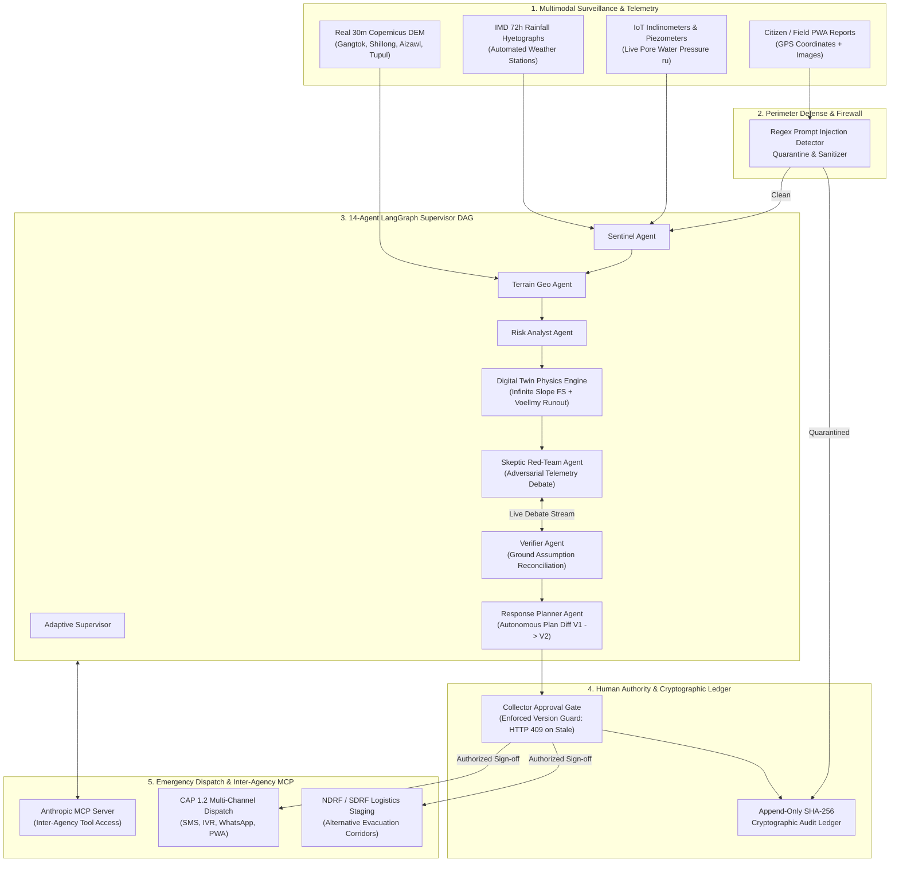

# RESQ.AI · BhuRaksha — Autonomous Multi-Agent Landslide Intelligence Platform

[]()
[]()
[]()
[]()
[]()
[]()

> **System Mission:** Autonomous Multi-Agent Landslide Early Warning, 3D Digital Twin Simulation, and Decision Support Platform for India's North Eastern Region (NER) and Himalayan corridors.  
> **Key Capabilities:** 14-Agent LangGraph DAG · Real 30m Copernicus DEM Elevation Rasters · Infinite-Slope & Voellmy-Salm Physics Solvers · Cryptographic Human-in-the-Loop Approval Gate · CAP 1.2 Multi-Channel Alert Dispatch · Anthropic MCP Server Integration.

---

## 📑 Table of Contents
1. [System Highlights & "Wow Moments"](#-system-highlights--wow-moments)
2. [Complete Technology Stack](#-complete-technology-stack)
3. [Team Responsibility & Stack Division (4 Members)](#-team-responsibility--stack-division-4-members)
4. [Architecture & Workflow](#-architecture--workflow)
5. [How to Run the Project](#-how-to-run-the-project)
   - [Prerequisites](#prerequisites)
   - [Option 1: Quickstart (Local Development)](#option-1-quickstart-local-development---recommended)
   - [Option 2: Docker Compose (Full Stack)](#option-2-docker-compose-full-stack)
   - [Option 3: Running Tests & Verifications](#option-3-running-tests--verifications)
6. [Default RBAC Demo Credentials](#-default-rbac-demo-credentials)
7. [Repository Structure](#-repository-structure)
8. [Comprehensive Documentation Index](#-comprehensive-documentation-index)

---

## 🌟 System Highlights & "Wow Moments"

### 1. Agents at Work, Visibly (14-Agent LangGraph DAG)
An interactive, transparent multi-agent execution graph where specialist agents (**Adaptive Supervisor, Sentinel, Terrain Geo, Risk Analyst, Digital Twin, Verifier, Field Intel, Exposure, Infrastructure, Response Planner, Alert Comm, Dispatcher, Audit Ledger, and Skeptic Red-Team**) coordinate in real time. Each agent reports live execution latency, active tool calls, confidence matrices, and structured evidence.

### 2. Authentic 3D Landslide Digital Twin (Real 30m Copernicus DEM)
Himalayan terrain physics simulated across 4 primary North Eastern Region Areas of Interest (**Gangtok-NH10 Corridor, Shillong Bypass, Aizawl Ridge, and Tupul/Noney Escarpment**) built directly from **real Copernicus GLO-30 30-meter elevation rasters**:
$$\text{Rainfall Infiltration} \longrightarrow \text{Unsaturated Hydrology} \longrightarrow \text{Infinite-Slope } FS < 1.0 \longrightarrow \text{Voellmy-Salm Runout} \longrightarrow \text{Exposure Hazard}$$

### 3. Autonomous Re-Planning with Backend-Enforced Human Gate
When an emergency perturbation occurs (e.g., $+65\text{ mm}$ cloudburst spike or rockfall blocking NH-10 KM-18), the **Verifier Agent** invalidates ground stability assumptions. The system autonomously generates **Plan V2** with an auditable structural diff ($\color{green}\text{+Added}$, $\color{orange}\sim\text{Changed}$, $\color{gray}=\text{Preserved}$), while the backend strictly enforces RBAC and rejects stale approvals with **HTTP 409 Conflict**.

### 4. Adversarial Skeptic & Red-Team Defense
An internal **Skeptic Red-Team Agent** challenges incoming sensor anomalies to eliminate false alarms from telemetry drift before presenting recommendations to human authorities. An integrated security firewall intercepts and quarantines prompt injection attacks into a tamper-evident SHA-256 cryptographic audit ledger.

---

## 💻 Complete Technology Stack

| Layer | Technologies & Libraries | Key Application in Platform |
|---|---|---|
| **Frontend Framework** | **React 18**, **JavaScript (ESM)**, **TypeScript** | High-command operations console, responsive dashboard, reactive state management |
| **Build & Bundler** | **Vite 5**, **PostCSS**, **Autoprefixer** | Sub-second HMR, tree-shaking, code-split production bundles (<6s build) |
| **3D Digital Twin** | **Three.js (WebGL)** | Real elevation mesh rendering, contour shaders, pore pressure saturation overlays, debris particle runouts |
| **Spatial GIS & Maps** | **MapLibre GL JS v6**, **Leaflet 1.9** | Micro-catchment hazard heatmaps, GSI national inventory overlays, live IoT sensor pins |
| **Data Viz & Charts** | **Recharts 3**, **D3.js** | Live hyetographs, ROC/AUC curves, TreeSHAP feature importances, Factor of Safety curves |
| **Styling & Icons** | **Tailwind CSS 3**, **Lucide React** | High-density dark tactical interface (`#06150C` palette) with unified mountain brand mark |
| **Backend Framework** | **FastAPI 0.143**, **Starlette**, **Uvicorn** | High-throughput asynchronous REST endpoints, WebSocket telemetry streams, auto OpenAPI /docs |
| **Multi-Agent Engine** | **LangGraph 1.2**, **LangChain Core**, **LangSmith** | 14-Agent stateful DAG orchestration, conditional branching, replanning loops, and distributed trace logging |
| **ML & Statistics** | **XGBoost 3.4**, **Scikit-Learn 1.9**, **SHAP**, **Pandas**, **NumPy**, **SciPy** | Spatial-block K-fold susceptibility ($0.979 \pm 0.009$ ROC-AUC), TreeSHAP local explainability, Monte-Carlo ensembles |
| **Physics & Solvers** | Closed-Form Geotechnical Limit Equilibrium & **Voellmy-Salm Dynamics** | Unsaturated infiltration, Infinite-Slope Factor of Safety ($FS$), and fluid-friction runout kinematics |
| **Inter-Agency Tools** | **Anthropic Model Context Protocol (MCP)** | Standardized agent tool server (`risk_assess`, `sim_run`, `gis_exposure`, `report_triage`, `alert_dispatch`) |
| **Database & Cache** | **PostgreSQL 16 + PostGIS**, **SQLite / aiosqlite**, **Redis 7** | Spatial queries, polygon intersections, event bus pub/sub, and zero-dependency local fallback DB |
| **Security & Auth** | **PyJWT**, **Bcrypt**, **SHA-256 Hash Chain** | Cryptographic RBAC, immutable tamper-evident audit ledger, regex injection sanitization |
| **Emergency Comms** | **CAP 1.2 (Common Alerting Protocol)**, SMS Gateway | Multi-channel hazard alert formatting, SMS/IVR templates, citizen PWA dispatch |
| **Testing & CI/CD** | **Pytest 9.1**, **Pytest-Asyncio**, **Playwright** | 86 comprehensive backend unit & integration tests, E2E browser verification |
| **DevOps** | **Docker**, **Docker Compose**, **Makefile** | Multi-container production deployment (PostGIS, Redis, FastAPI, Nginx) |

---

## 👥 Team Responsibility & Stack Division (4 Members)

To ensure clear ownership, specialization, and confident presentation defense during technical evaluations, the platform is cleanly divided across 4 engineering roles:

```
┌────────────────────────────────────────────────────────────────────────────────────────┐
│                        RESQ.AI · BHURAKSHA TEAM OWNERSHIP MATRIX                      │
├────────────────────────────┬────────────────────────────┬──────────────────────────────┤
│ Member 1: AI / Agents Lead │ Member 2: GeoAI & Physics  │ Member 3: 3D GIS & Frontend │
│ • LangGraph 14-Agent DAG   │ • Copernicus 30m DEM GLO30 │ • Three.js 3D Digital Twin   │
│ • Adaptive Re-planning     │ • Voellmy-Salm Runout Sim  │ • MapLibre & Leaflet 2D GIS  │
│ • Skeptic Red-Team Debate  │ • XGBoost Susceptibility   │ • Mission Control UI / UX    │
│ • Human Gate & MCP Server  │ • TreeSHAP & Monte-Carlo   │ • Real-time Perturbation HUD │
├────────────────────────────┴────────────────────────────┴──────────────────────────────┤
│ Member 4: Backend, Infrastructure & Disaster Communications Lead                       │
│ • FastAPI Async Core & WebSockets  • PostgreSQL / PostGIS & Redis Telemetry Pub/Sub   │
│ • CAP 1.2 Emergency Alert Gateway  • Docker Compose & 86-Test Verification Suite       │
└────────────────────────────────────────────────────────────────────────────────────────┘
```

### 👤 Member 1: Team Lead & AI / Multi-Agent Systems Engineer
- **Core Domain:** Multi-Agent Orchestration, LLM Decision Systems, Model Context Protocol (MCP), and Governance.
- **Key Responsibilities:**
  1. **14-Agent LangGraph Orchestrator:** Designed and implemented the cyclical state graph connecting Sentinel, Terrain Geo, Risk Analyst, Simulation Twin, Verifier, and Response Planner agents (`backend/app/agents/orchestrator.py`).
  2. **Adaptive Re-planning Engine:** Engineered the dynamic task invalidation logic that regenerates response plans upon weather or road obstruction perturbations with visual structural diffs (`backend/app/agents/adaptive_supervisor.py`).
  3. **Skeptic Red-Team Agent:** Created internal adversarial debate loops to cross-examine sensor anomalies against physical baseline rules before human sign-off (`backend/app/agents/skeptic.py`).
  4. **Human Approval Gate & RBAC:** Enforced state-bound version guards returning **HTTP 409 Conflict** on stale plan approvals.
  5. **Anthropic Model Context Protocol (MCP):** Implemented the 5 MCP operational tools exposing platform capabilities to external AI clients (`backend/app/mcp/server.py`).
- **Defense Focus:** Agent convergence guarantees, cyclic state graph recovery, hallucination mitigation via physical boundary constraints, and prompt injection defense.

---

### 👤 Member 2: Geospatial AI & Physical Simulation Engineer
- **Domain:** Geotechnical Physics, Digital Twin Simulation, Terrain Processing, and Machine Learning.
- **Key Responsibilities:**
  1. **Copernicus DEM 30m Ingestion:** Sourced, clipped, and cached real 30m elevation rasters for Gangtok, Shillong, Aizawl, and Tupul (`backend/app/geospatial/terrain.py`).
  2. **Closed-Form Geotechnical Stability:** Implemented the Infinite-Slope Limit Equilibrium model calculating dynamic Factor of Safety ($FS$) as a function of slope, cohesion, friction angle, and pore pressure ratio ($r_u$).
  3. **Voellmy-Salm Fluid Runout Solver:** Coded the 2D debris flow momentum equation accounting for turbulent fluid drag and Coulomb dry friction (`backend/app/simulation/voellmy_solver.py`).
  4. **Spatial-Block XGBoost Susceptibility:** Trained and calibrated the susceptibility model achieving **$0.979 \pm 0.009$ ROC-AUC** across non-overlapping spatial clusters (`backend/app/ml/xgboost_model.py`).
  5. **Explainability & Historical Benchmarking:** Integrated TreeSHAP feature attribution and benchmarked against Tupul 2022, Gangtok 2020, and Aizawl 2024 disaster datasets.
- **Defense Focus:** Physical validity of slope stability models, handling DEM edge artifacts, spatial autocorrelation prevention during ML training, and lead-time accuracy.

---

### 👤 Member 3: Frontend Lead & 3D WebGL / GIS Visualization Engineer
- **Domain:** Frontend Architecture, 3D WebGL Digital Twin, Spatial GIS Command, and Mission Control UI/UX.
- **Key Responsibilities:**
  1. **3D Himalayan Digital Twin:** Engineered the Three.js WebGL terrain renderer with dynamic height-map displacement, custom elevation shaders, pore pressure overlays, and particle debris animation (`apps/web/src/components/DigitalTwin3D.jsx`).
  2. **Spatial GIS Risk Command:** Integrated MapLibre GL JS v6 and Leaflet for real-time regional slope heatmaps, micro-catchments, and live telemetry pin rendering (`apps/web/src/terraguard/components/SpatialGisCommand.tsx`).
  3. **High-Command Mission Control UI:** Built the unified operations console featuring the live 14-agent DAG execution visualizer, real-time telemetry feeds, and debate streams (`apps/web/src/pages/MissionControl.jsx`).
  4. **Interactive Scenario Director:** Created the perturbation controls (+65mm rainfall spike, rockfall road blockage) and interactive plan diff comparisons.
  5. **Performance & Clean Design:** Optimized Vite build to <6 seconds with dynamic code splitting, zero double headers, and unified brand mark styling.
- **Defense Focus:** WebGL GPU draw call optimization, responsive canvas resizing, coordinate projection alignment between Leaflet/MapLibre and Three.js, and accessible tactical UX.

---

### 👤 Member 4: Backend, Database & Disaster Communications Lead
- **Domain:** Backend API Services, Telemetry Streaming, Spatial Database, Alert Gateway, and DevOps.
- **Key Responsibilities:**
  1. **FastAPI Asynchronous Engine:** Architected the REST and WebSocket API backbones handling live sensor streams, incident lifecycles, and verification triage (`backend/app/main.py`).
  2. **Spatial Data Layer & Cache:** Deployed PostgreSQL 16 with PostGIS extensions for spatial bounding box queries, complemented by SQLite/aiosqlite for standalone zero-dependency execution.
  3. **Redis Real-Time Telemetry Mesh:** Configured Redis 7 pub/sub for instantaneous event distribution between sensory feeds, agent supervisors, and connected web clients.
  4. **CAP 1.2 Multi-Channel Alert Gateway:** Implemented Common Alerting Protocol v1.2 generation with automated SMS, IVR voice templates, and citizen PWA pushes (`backend/app/terraguard/routers/alerts.py`).
  5. **Testing Harness & Containerization:** Built the multi-container Docker Compose pipeline and authored 86 automated Pytest tests validating every API, physics, and agent endpoint.
- **Defense Focus:** Asynchronous concurrency under heavy telemetry load, database transaction safety during emergency state transitions, CAP XML compliance, and container failover.

---

## 🏛️ Architecture & Workflow



---

## 🚀 How to Run the Project

### Prerequisites
- **Node.js**: v18.0+ (v20+ or v24 recommended)
- **Python**: v3.10, v3.11, or v3.12
- **Docker & Docker Compose**: (Optional, required only for full containerized stack)

---

### Option 1: Quickstart (Local Development) - *Recommended*

#### Step 1: Clone the repository
```bash
git clone https://github.com/your-username/RESQ.git
cd RESQ
```

#### Step 2: Set up Python Virtual Environment & Dependencies
```bash
# Create and activate virtual environment
python3 -m venv .venv
source .venv/bin/activate

# Install backend dependencies
pip install --upgrade pip
pip install -r requirements.txt
```

#### Step 3: Install Frontend Dependencies
```bash
cd apps/web
npm install
cd ../..
```

#### Step 4: Seed Database & RBAC Users
```bash
make seed
# Or manually:
PYTHONPATH=. .venv/bin/python3 -c "import asyncio; from backend.app.db.database import db; from backend.app.db.seed import seed_users; asyncio.run(db.init()); asyncio.run(seed_users())"
```

#### Step 5: Launch Backend and Frontend
You can launch both concurrently using the Makefile:
```bash
make up
```
Or start them in two separate terminal tabs:

**Terminal 1 (Backend API):**
```bash
source .venv/bin/activate
PYTHONPATH=. uvicorn backend.app.main:app --host 0.0.0.0 --port 8000 --reload
```

**Terminal 2 (Frontend Web App):**
```bash
cd apps/web
npm run dev
```

- **Web Application:** Open [http://localhost:3000](http://localhost:3000) or [http://localhost:5173](http://localhost:5173) in your browser.
- **Interactive OpenAPI Docs:** Open [http://localhost:8000/docs](http://localhost:8000/docs).
- **Secondary Geotech API Docs:** Open [http://localhost:8000/terraguard/docs](http://localhost:8000/terraguard/docs).

---

### Option 2: Docker Compose (Full Stack)

To run the complete production container stack (PostGIS database, Redis cache, FastAPI backend, and Nginx web app):

```bash
# Build and launch all containers in detached mode
docker compose up -d --build

# Check status of running containers
docker compose ps

# View live service logs
docker compose logs -f backend
```

- Web Console: **`http://localhost:3000`**
- API Documentation: **`http://localhost:8000/docs`**

To stop the containers:
```bash
docker compose down
```

---

### Option 3: Running Tests & Verifications

The repository includes a comprehensive 86-test suite covering agent logic, Voellmy physics, API routes, security defenses, and terrain processing.

```bash
# Run full Pytest backend test suite (86/86 passing)
make test
# Or directly:
PYTHONPATH=. .venv/bin/pytest -v backend/tests/

# Verify frontend production build (TypeScript + JSX)
make build
# Or directly:
cd apps/web && npm run build

# Run automated end-to-end 3-minute validation demo
make demo

# Run all verification gates at once (Tests + Build + Validation)
make verify
```

---

## 👥 Default RBAC Demo Credentials

Use these pre-configured user credentials to explore different role-based views and authority levels:

| Role | Email | Password | Permissions & Available Features |
|---|---|---|---|
| **District Collector (Approver)** | `collector@bhuraksha.demo` | `Approve@RESQ26` | Full Human Approval Gate authority, emergency CAP alert dispatch, plan diff authorization |
| **Incident Operator** | `operator@bhuraksha.demo` | `Operate@RESQ26` | Create incidents, trigger environmental perturbations, execute scenario runs |
| **Geotechnical Analyst** | `analyst@bhuraksha.demo` | `Analyze@RESQ26` | Digital Twin inspection, Monte-Carlo physics parameter adjustments, InSAR analysis |
| **Field Officer** | `field@bhuraksha.demo` | `Field@RESQ26` | Review and verify citizen ground hazard reports, inspect CV bounding boxes |
| **Citizen / Reporter** | `citizen@bhuraksha.demo` | `Citizen@RESQ26` | Submit geo-tagged observations and photos via PWA interface |

---

## 📂 Repository Structure

```
RESQ/
├── apps/
│   └── web/                         # React 18 + Vite 5 Frontend Application
│       ├── src/
│       │   ├── components/          # Reusable UI & Operations Console Components
│       │   │   ├── DigitalTwin3D.jsx       # Three.js 3D WebGL Himalayan terrain
│       │   │   ├── Shell.jsx               # Unified top command bar & navigation
│       │   │   ├── ScenarioDirector.jsx    # Real-time perturbation & scenario triggers
│       │   │   ├── PlanPanel.jsx           # V1 vs V2 structural diff visualizer
│       │   │   ├── SkepticDebate.jsx       # Live adversarial agent debate feed
│       │   │   └── RedTeamPanel.jsx        # Live prompt injection testing panel
│       │   ├── geoshield/           # NER IoT Sensor Grid & Telemetry module
│       │   ├── terraguard/          # Regional Geotechnical & ML Intelligence module
│       │   ├── pages/               # High-command routes (Mission Control, Sim Lab, etc.)
│       │   └── lib/api.js           # Centralized API client & AuthProvider
│       └── package.json
│
├── backend/
│   ├── app/
│   │   ├── agents/                  # 14-Agent LangGraph Multi-Agent Engine
│   │   │   ├── orchestrator.py      # Master supervisor state graph
│   │   │   ├── adaptive_supervisor.py # Dynamic re-planning on perturbation
│   │   │   ├── skeptic.py           # Adversarial false-alarm challenge agent
│   │   │   └── evidence_reconciliation.py # Assumption validation ledger
│   │   ├── api/                     # REST API route handlers
│   │   ├── geospatial/              # Copernicus 30m DEM & network routing
│   │   ├── simulation/              # Infinite-Slope & Voellmy-Salm physics solvers
│   │   ├── ml/                      # XGBoost & Random Forest susceptibility models
│   │   ├── mcp/                     # Anthropic Model Context Protocol server
│   │   └── terraguard/              # CAP alert gateway, weather & seismic services
│   └── tests/                       # 86 Pytest integration & unit test suite
│
├── data/                            # Cached Copernicus 30m DEM rasters & inventories
├── docs/                            # In-depth architectural & scientific documentation
├── scripts/                         # Terrain tile builders, demo runners, benchmarks
├── docker-compose.yml               # Multi-container production deployment specification
├── Makefile                         # Unified development, test, and build automation
└── requirements.txt                 # Pinned Python dependencies
```

---

## 📚 Comprehensive Documentation Index

All technical documents, mathematical formulations, and defense reports are organized in the [`docs/`](docs/) directory:

| Document | Description |
|---|---|
| 🏛️ **[System Architecture](docs/architecture.md)** | Full architectural breakdown, multimodal surveillance layers, agent state machine, and data flow diagrams. |
| 🧪 **[Simulation Physics & Formulations](docs/simulation-model.md)** | Derivations of the Infinite-Slope Limit Equilibrium model, unsaturated infiltration, and Voellmy-Salm runout equations. |
| 📊 **[Validation & Hindcast Report](docs/validation-report.md)** | Empirical benchmarks against historical disasters: Tupul 2022 ($10\text{h}$ lead time), Gangtok 2020 ($7\text{h}$ lead time), and Aizawl 2024 ($2\text{h}$ lead time). |
| 🛡️ **[Technical Q&A Defense Guide](docs/judge-qa.md)** | 30+ detailed answers to challenging questions regarding physical validity, agent convergence, latency, and false positives. |
| 🔍 **[Truth Audit & Credibility Report](docs/truth-report.md)** | Transparent differentiation between real empirical data (30m DEM, GSI inventories) and simulated sensor telemetry. |
| ⚠️ **[Scientific & Operational Limitations](docs/limitations.md)** | Complete analysis of epistemic boundaries, sensor mesh density requirements, and non-statutory decision-support guidelines. |
| 🌐 **[Model Context Protocol (MCP) Spec](docs/mcp.md)** | JSON schemas and invocation protocols for the 5 inter-agency agent tools. |
| 🗺️ **[Data Provenance](docs/data-provenance.md)** | Sourcing and licensing for Copernicus GLO-30 DEM, IMD hyetographs, and GSI landslide inventories. |
| 🧭 **[Georeferencing Calibration](docs/georeferencing.md)** | Mathematical coordinate transforms between WGS84, UTM Projection, and Three.js local Cartesian coordinates. |
| 🔬 **[Simulation Validation](docs/simulation-validation.md)** | Monte-Carlo parametric sweeps and sensitivity analysis across geotechnical variables. |

---

## 📄 License

This project is licensed under the **MIT License** — see the [LICENSE](LICENSE) file for details.  
*Disclaimer: BhuRaksha × RESQ.AI is an AI-assisted decision-support platform designed to augment statutory emergency authorities (NDMA/SDMA). It operates alongside official early warning protocols.*
