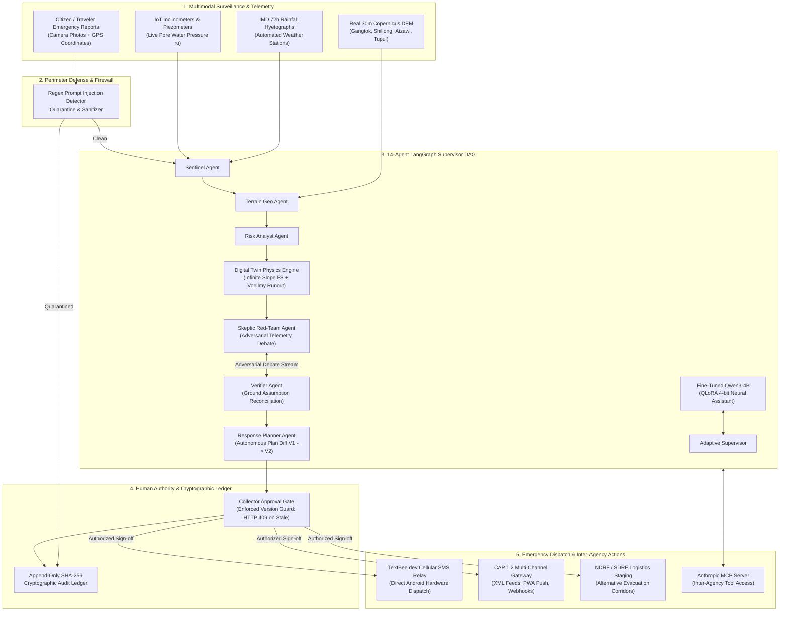

# RESQ.AI · BhuRaksha — Autonomous Multi-Agent Landslide & Disaster Intelligence Platform

[]()
[]()
[]()
[]()
[]()
[]()
[]()
[]()

> **System Mission:** Autonomous Multi-Agent Landslide Early Warning, 3D Digital Twin Simulation, and Decision Support Platform tailored for India's North Eastern Region (NER) and high-risk Himalayan transit corridors.  
> **Key Capabilities:** 14-Agent LangGraph Cyclical DAG · Local Fine-Tuned Qwen3-4B QLoRA Assistant · Real 30m Copernicus GLO-30 DEM Elevation Rasters · Infinite-Slope & Voellmy-Salm Physics Solvers · TextBee.dev Autonomous Hardware SMS Dispatch · Traveler Emergency Camera Reporting · Cryptographic Human-in-the-Loop Approval Gate · Append-Only SHA-256 Audit Ledger.

---

## 📑 Table of Contents
1. [System Highlights & Architectural Innovations](#-system-highlights--architectural-innovations)
2. [Complete Technology Stack](#-complete-technology-stack)
3. [Team Responsibility & Stack Division (4 Members)](#-team-responsibility--stack-division-4-members)
4. [Architecture & Information Flow](#-architecture--information-flow)
5. [How to Run the Project](#-how-to-run-the-project)
   - [Prerequisites](#prerequisites)
   - [Step 1: Clone Repository](#step-1-clone-repository)
   - [Step 2: Environment Configuration (.env)](#step-2-environment-configuration-env)
   - [Step 3: Backend Python Environment & Dependencies](#step-3-backend-python-environment--dependencies)
   - [Step 4: Frontend Dependencies](#step-4-frontend-dependencies)
   - [Step 5: Database Seeding & RBAC Initialization](#step-5-database-seeding--rbac-initialization)
   - [Step 6: Launch Backend & Frontend Concurrently](#step-6-launch-backend--frontend-concurrently)
   - [Local LLM & GPU Inference Configuration](#local-llm--gpu-inference-configuration)
   - [TextBee SMS Gateway Setup & Testing](#textbee-sms-gateway-setup--testing)
6. [Testing & Verification Suites](#-testing--verification-suites)
7. [Default RBAC Demo Credentials](#-default-rbac-demo-credentials)
8. [Repository Structure](#-repository-structure)
9. [Comprehensive Documentation Index](#-comprehensive-documentation-index)
10. [License & Disclaimer](#-license--disclaimer)

---

## 🌟 System Highlights & Architectural Innovations

### 1. Agents at Work, Visibly (14-Agent LangGraph DAG)
An interactive, transparent multi-agent execution graph where specialist agents coordinate in real time:
- **Adaptive Supervisor:** Manages global state transitions, tracks multi-agent convergence, and coordinates dynamic re-planning loops.
- **Sentinel Agent:** Ingests live telemetry (rainfall hyetographs, piezometers, inclinometers) and filters drift anomalies.
- **Terrain Geo Agent:** Evaluates slope angles, geological formations, catchment geometry, and Copernicus 30m elevation rasters.
- **Risk Analyst Agent:** Computes probabilistic hazard susceptibility using calibrated XGBoost ensembles ($0.979 \pm 0.009$ ROC-AUC).
- **Digital Twin Engine:** Simulates 3D geotechnical physics using Infinite-Slope Factor of Safety ($FS$) and Voellmy-Salm fluid runout dynamics.
- **Skeptic Red-Team Agent:** Challenges incoming anomalies through adversarial debate loops to eliminate sensor false alarms.
- **Verifier Agent:** Ingests real-world evidence to reconcile ground assumptions and trigger re-planning when conditions change.
- **Response Planner Agent:** Autonomously computes resource allocations and generates auditable plan diffs ($\color{green}\text{+Added}$, $\color{orange}\sim\text{Changed}$, $\color{gray}=\text{Preserved}$).
- **Alert Comm & Dispatcher:** Transmits automated multi-channel CAP 1.2 alerts and cellular SMS dispatches.
- **Audit Ledger:** Maintains an append-only SHA-256 cryptographic chain capturing all decisions and approvals.

### 2. Fine-Tuned Local Qwen3-4B Assistant (QLoRA + 4-Bit NF4)
An integrated, locally hosted neural assistant based on `Qwen/Qwen3-4B`, fine-tuned via QLoRA (Rank 16, Alpha 32) on domain-specific geotechnical and disaster response datasets.
- **Low VRAM Footprint:** Uses bitsandbytes 4-bit NF4 quantization to execute efficiently within ~3.5GB VRAM.
- **Fail-Safe Deterministic Fallback:** Automatically switches to structured deterministic heuristics if no GPU is available or if model loading is disabled (`QWEN_ENABLED=false`).
- **Safety & Relevancy Guard:** Trained strictly on landslide, earthquake, road blockage, evacuation, and meteorological queries; non-disaster and social pleasantries are politely grounded without hallucinating irrelevant alerts.

### 3. Authentic 3D Landslide Digital Twin (Real 30m Copernicus DEM)
Himalayan terrain physics simulated across 4 primary North Eastern Region Areas of Interest (**Gangtok-NH10 Corridor, Shillong Bypass, Aizawl Ridge, and Tupul/Noney Escarpment**) built directly from **real Copernicus GLO-30 30-meter elevation rasters**:
$$\text{Rainfall Infiltration} \longrightarrow \text{Pore Water Pressure } r_u \longrightarrow \text{Infinite-Slope } FS < 1.0 \longrightarrow \text{Voellmy-Salm Runout} \longrightarrow \text{Infrastructure Exposure}$$

### 4. TextBee.dev SMS Gateway Integration (Hardware Cellular Relay)
Direct integration with [TextBee.dev](https://textbee.dev) turns any Android smartphone into an automated cellular SMS dispatch gateway.
- Enables autonomous transmission of high-priority evacuation orders and roadblock warnings directly over cellular carrier networks without requiring internet access on the receiving device.
- Configurable via `.env` or interactively from the **Officer Profile / Admin Console** (`/agent`), complete with live test SMS transmission to any phone number.

### 5. Citizen & Traveler Emergency Hazard Reporting
A responsive traveler emergency reporting portal with:
- **Live Camera Capture Modal:** Captures instant photo snapshots or accepts uploaded evidence from mobile and desktop browsers.
- **Geo-Tagging & Automated Triage:** Automatic extraction of device GPS coordinates, client-side triage categorization, and CV hazard verification.
- **Emergency Offline Resilience:** Immediate confirmation, local storage sync, and automated incident severity assignment.

### 6. Cryptographic Human Authority Gate & Immutable Ledger
When a severe hazard or environmental perturbation is verified:
- The system generates **Plan V2** with an auditable structural diff.
- Execution is gated by a **District Collector / Approver Gate**.
- The backend strictly enforces state-bound version guards, returning **HTTP 409 Conflict** on stale approvals.
- All actions, model tool calls, and sign-offs are hashed into a tamper-evident SHA-256 audit ledger.

---

## 💻 Complete Technology Stack

| Layer | Technologies & Libraries | Key Application in Platform |
|---|---|---|
| **Frontend Framework** | **React 18**, **TypeScript**, **JavaScript (ESM)** | High-command operations console, responsive dashboard, reactive state management |
| **Build & Bundler** | **Vite 5**, **PostCSS**, **Autoprefixer** | Sub-second HMR, tree-shaking, code-split production bundles (<6s build) |
| **3D Digital Twin** | **Three.js (WebGL)** | Real elevation mesh rendering, contour shaders, pore pressure saturation overlays, debris particle runouts |
| **Spatial GIS & Maps** | **MapLibre GL JS v6**, **Leaflet 1.9** | Micro-catchment hazard heatmaps, GSI national inventory overlays, live IoT sensor pins |
| **Data Viz & Charts** | **Recharts 3**, **D3.js** | Live hyetographs, ROC/AUC curves, TreeSHAP feature importances, Factor of Safety curves |
| **Styling & UI** | **Tailwind CSS 3**, **Lucide React** | High-density dark tactical interface (`#06150C` palette) with custom modal and slider components |
| **Backend Core** | **FastAPI 0.143**, **Starlette**, **Uvicorn** | High-throughput asynchronous REST endpoints, WebSocket telemetry streams, auto OpenAPI docs |
| **Multi-Agent Engine** | **LangGraph 1.2**, **LangChain Core**, **LangSmith** | 14-Agent cyclical state graph orchestration, dynamic re-planning, and distributed trace logging |
| **Local LLM & QLoRA** | **Qwen3-4B**, **PyTorch 2.14**, **Hugging Face Transformers**, **PEFT**, **BitsAndBytes**, **TRL** | Domain-fine-tuned assistant, 4-bit NF4 quantized local inference, low-VRAM memory management |
| **ML & Statistics** | **XGBoost 3.4**, **Scikit-Learn 1.9**, **SHAP**, **Pandas**, **NumPy**, **SciPy** | Spatial-block K-fold susceptibility ($0.979 \pm 0.009$ ROC-AUC), TreeSHAP local explainability, Monte-Carlo sweeps |
| **Physics & Solvers** | Closed-Form Geotechnical Limit Equilibrium & **Voellmy-Salm Dynamics** | Unsaturated infiltration, Infinite-Slope Factor of Safety ($FS$), and fluid-friction runout kinematics |
| **Emergency Comms** | **TextBee.dev SMS Gateway**, **CAP 1.2 Protocol** | Hardware Android cellular SMS dispatch, CAP 1.2 multi-channel XML alert templates, PWA pushes |
| **Database & Cache** | **SQLite / aiosqlite**, **PostgreSQL 16 + PostGIS**, **Redis 7** | Spatial queries, zero-dependency standalone local execution, event pub/sub |
| **Security & Auth** | **PyJWT**, **Bcrypt**, **SHA-256 Hash Chain** | Role-Based Access Control (RBAC), tamper-evident audit ledger, regex injection sanitization |
| **Testing Harness** | **Pytest 9.1**, **Pytest-Asyncio** | 103 automated backend integration & unit tests, physics validations, and agent test suites |

---

## 👥 Team Responsibility & Stack Division (4 Members)

To ensure clear ownership, specialization, and confident presentation defense during technical evaluations, the platform is cleanly divided across 4 engineering roles:

```
┌────────────────────────────────────────────────────────────────────────────────────────┐
│                        RESQ.AI · BHURAKSHA TEAM OWNERSHIP MATRIX                      │
├────────────────────────────┬────────────────────────────┬──────────────────────────────┤
│ Member 1: AI / Agents Lead │ Member 2: GeoAI & Physics  │ Member 3: 3D GIS & Frontend │
│ • LangGraph 14-Agent DAG   │ • Copernicus 30m DEM GLO30 │ • Three.js 3D Digital Twin   │
│ • Local Qwen3-4B QLoRA SFT │ • Voellmy-Salm Runout Sim  │ • MapLibre & Leaflet 2D GIS  │
│ • Adaptive Re-planning     │ • XGBoost Susceptibility   │ • Mission Control UI / UX    │
│ • Skeptic Red-Team Debate  │ • TreeSHAP & Monte-Carlo   │ • Camera Capture & Reports   │
├────────────────────────────┴────────────────────────────┴──────────────────────────────┤
│ Member 4: Backend, Infrastructure & Disaster Communications Lead                       │
│ • FastAPI Async Core & WebSockets  • SQLite / PostGIS & Redis Telemetry Mesh          │
│ • TextBee SMS & CAP 1.2 Gateway    • Automated Verification Suite (103 Tests)          │
└────────────────────────────────────────────────────────────────────────────────────────┘
```

### 👤 Member 1: AI / Multi-Agent & Fine-Tuning Systems Engineer
- **Core Domain:** Multi-Agent Orchestration, Domain SFT / QLoRA, Agent Governance.
- **Key Deliverables:**
  1. **14-Agent LangGraph Graph:** Master supervisor graph connecting Sentinel, Terrain Geo, Risk Analyst, Simulation Twin, Skeptic, and Planner agents (`backend/app/agents/orchestrator.py`).
  2. **Domain QLoRA Fine-Tuning:** Trained `Qwen/Qwen3-4B` with Low-Rank Adaptation (LoRA $r=16, \alpha=32$) on domain disaster prompts with fallback heuristics (`backend/app/ml/qlora_finetune.py`, `backend/app/ml/qwen_service.py`).
  3. **Adaptive Re-planning Engine:** Dynamic task invalidation logic that regenerates response plans with visual diffs upon weather or blockage perturbations (`backend/app/agents/adaptive_supervisor.py`).
  4. **Skeptic Red-Team Debate:** Adversarial agent loops that cross-examine incoming telemetry against physical rules before alerts reach human gates (`backend/app/agents/skeptic.py`).

### 👤 Member 2: Geospatial AI & Physical Simulation Engineer
- **Core Domain:** Geotechnical Physics, Digital Twin Simulation, Terrain Processing, and Machine Learning.
- **Key Deliverables:**
  1. **Copernicus DEM 30m Ingestion:** Sourced, clipped, and cached real 30m elevation rasters for Gangtok, Shillong, Aizawl, and Tupul (`backend/app/geospatial/terrain.py`).
  2. **Infinite-Slope Limit Equilibrium:** Formulated the dynamic Factor of Safety ($FS$) as a function of slope, cohesion, friction angle, and pore pressure ratio ($r_u$).
  3. **Voellmy-Salm Runout Solver:** 2D debris flow momentum solver accounting for turbulent fluid drag and Coulomb dry friction (`backend/app/simulation/voellmy_solver.py`).
  4. **Spatial-Block XGBoost Susceptibility:** Trained susceptibility model achieving **$0.979 \pm 0.009$ ROC-AUC** across non-overlapping spatial clusters (`backend/app/ml/xgboost_model.py`).

### 👤 Member 3: Frontend Lead & 3D WebGL / GIS Visualization Engineer
- **Core Domain:** Frontend Architecture, 3D WebGL Digital Twin, Spatial GIS Command, and Tactical UI/UX.
- **Key Deliverables:**
  1. **3D Himalayan Digital Twin:** Three.js WebGL terrain renderer with dynamic height-map displacement, custom elevation shaders, pore pressure overlays, and particle debris animation (`apps/web/src/components/DigitalTwin3D.jsx`).
  2. **Spatial GIS Risk Command:** MapLibre GL JS v6 and Leaflet implementation for real-time slope heatmaps, micro-catchments, and live telemetry pin rendering (`apps/web/src/terraguard/components/SpatialGisCommand.tsx`).
  3. **Operations Console & Agent Dashboard:** Unified operations console featuring live 14-agent DAG execution visualizers, debate streams, and officer dashboard (`apps/web/src/pages/MissionControl.jsx`, `apps/web/src/pages/AgentDashboard.jsx`).
  4. **Camera Capture & Citizen Reporting:** Built responsive mobile-friendly camera capture modal and citizen reporting interface (`apps/web/src/components/CameraCaptureModal.jsx`, `apps/web/src/components/TravelerEmergencyReport.jsx`).

### 👤 Member 4: Backend, Database & Disaster Communications Lead
- **Core Domain:** Backend API Architecture, Cellular Alert Gateway, Database Layer, and DevOps.
- **Key Deliverables:**
  1. **FastAPI Asynchronous Engine:** Asynchronous REST and WebSocket backbones handling live sensor streams, incident lifecycles, and verification triage (`backend/app/main.py`).
  2. **TextBee.dev Hardware SMS Gateway:** End-to-end integration with Android SMS gateway relays for autonomous cellular dispatch (`backend/app/services/textbee_service.py`, `backend/app/api/sms.py`).
  3. **Spatial Data Layer & RBAC:** SQLite/aiosqlite database with role-based access control, cryptographic password hashing, and seed management (`backend/app/db/`).
  4. **Testing Harness & Containerization:** Authored 103 automated Pytest tests validating API contracts, physics formulas, Qwen inference, and SMS gateway functions.

---

## 🏛️ Architecture & Information Flow



---

## 🚀 How to Run the Project

### Prerequisites
- **Node.js**: v18.0+ (v20+ or v24 recommended)
- **Python**: v3.10, v3.11, or v3.12
- **CUDA-Capable GPU** *(Optional)*: Recommended for 4-bit local Qwen3-4B inference (uses ~3.5GB VRAM). If no GPU is available, the platform automatically runs in deterministic rule-based mode.

---

### Step 1: Clone Repository
```bash
git clone https://github.com/your-username/RESQ.git
cd RESQ
```

---

### Step 2: Environment Configuration (.env)
Copy the provided `.env.example` template to `.env`:
```bash
cp .env.example .env
```
Open `.env` and review the default configuration. All essential keys have sensible defaults for instant local development.
> [!TIP]
> If you wish to enable live cellular SMS notifications via your Android smartphone, provide your **TextBee API Key** and **Device ID** in `.env` (or configure them later via the Web UI).

---

### Step 3: Backend Python Environment & Dependencies
Create and activate a virtual environment, then install all requirements:
```bash
# Create and activate Python virtual environment
python3 -m venv .venv
source .venv/bin/activate

# Upgrade pip and install dependencies
pip install --upgrade pip
pip install -r requirements.txt
```

---

### Step 4: Frontend Dependencies
Install the React + Vite frontend packages:
```bash
cd apps/web
npm install
cd ../..
```

---

### Step 5: Database Seeding & RBAC Initialization
Seed the SQLite database with default disaster management roles, seed accounts, and reference geospatial boundaries:
```bash
make seed
```
*(Or run manually via Python:)*
```bash
PYTHONPATH=. .venv/bin/python3 -c "import asyncio; from backend.app.db.database import db; from backend.app.db.seed import seed_users; asyncio.run(db.init()); asyncio.run(seed_users())"
```

---

### Step 6: Launch Backend & Frontend Concurrently
Start both the FastAPI backend server (port 8000) and the Vite frontend dev server (port 3000):
```bash
make up
```

Alternatively, you can launch them in separate terminal tabs:

**Terminal 1 (Backend API):**
```bash
source .venv/bin/activate
PYTHONPATH=. uvicorn backend.app.main:app --host 0.0.0.0 --port 8000 --reload
```

**Terminal 2 (Frontend Web Application):**
```bash
cd apps/web
npm run dev
```

- **Operations Console:** [http://localhost:3000](http://localhost:3000)
- **Agent Dashboard & Chat:** [http://localhost:3000/agent](http://localhost:3000/agent)
- **Traveler Hazard Reporter:** [http://localhost:3000/report](http://localhost:3000/report)
- **Interactive OpenAPI Docs:** [http://localhost:8000/docs](http://localhost:8000/docs)
- **Geotechnical Sub-Service Docs:** [http://localhost:8000/terraguard/docs](http://localhost:8000/terraguard/docs)

To stop running servers cleanly:
```bash
make down
```

---

### Local LLM & GPU Inference Configuration

The platform includes a local fine-tuned `Qwen/Qwen3-4B` assistant loaded using Hugging Face Transformers and bitsandbytes 4-bit NF4 quantization.

- **GPU Acceleration (Default):** Set `QWEN_LOAD_IN_4BIT=true` in `.env`. The model loads into ~3.5GB of GPU VRAM on first invocation and caches responses for lightning-fast subsequent queries.
- **CPU / Low-Resource Fallback:** If CUDA is unavailable or if `QWEN_ENABLED=false`, the platform automatically uses deterministic, high-accuracy geotechnical rules. All core agent DAGs, physics simulations, and SMS workflows function seamlessly regardless of GPU availability.
- **Fine-Tuning Execution:** To re-train or inspect the QLoRA adapter:
  ```bash
  source .venv/bin/activate
  python -m backend.app.ml.qlora_finetune --train
  ```

---

### TextBee SMS Gateway Setup & Testing

1. Create a free account at [TextBee.dev](https://textbee.dev) and install the TextBee Android APK on any smartphone.
2. Register the phone to obtain your **API Key** and **Device ID**.
3. Add these credentials to `.env` or paste them directly in the UI under **Officer Profile** on the `/agent` page.
4. Use the **"Send Test SMS"** panel in the Officer Profile to immediately verify real cellular dispatch to your personal mobile number.

---

## 🧪 Testing & Verification Suites

The repository is covered by 103 automated tests verifying backend API contracts, physics equations, agent DAG transitions, local Qwen inference, and SMS dispatch:

```bash
# Run full automated Pytest test suite (103/103 passing)
make test
# Or directly:
PYTHONPATH=. .venv/bin/pytest -v backend/tests/

# Verify production frontend build (TypeScript + JSX + PostCSS)
make build
# Or directly:
cd apps/web && npm run build

# Run end-to-end deterministic demonstration runner (<3 minutes)
make demo

# Run all verification gates (Tests + Build + Validation + Demo)
make verify
```

---

## 👥 Default RBAC Demo Credentials

Use these pre-configured user credentials to explore different role-based views and authority levels:

| Role | Email | Password | Permissions & Features |
|---|---|---|---|
| **District Collector (Approver)** | `collector@bhuraksha.demo` | `Approve@RESQ26` | Full Human Approval Gate authority, emergency CAP alert dispatch, plan diff authorization |
| **Incident Operator** | `operator@bhuraksha.demo` | `Operate@RESQ26` | Create incidents, trigger environmental perturbations, execute scenario runs |
| **Geotechnical Analyst** | `analyst@bhuraksha.demo` | `Analyze@RESQ26` | Digital Twin inspection, Monte-Carlo physics parameter adjustments, InSAR analysis |
| **Field Officer** | `field@bhuraksha.demo` | `Field@RESQ26` | Review and verify citizen ground hazard reports, test TextBee SMS dispatch, manage field profile |
| **Citizen / Traveler** | `citizen@bhuraksha.demo` | `Citizen@RESQ26` | Submit geo-tagged observations and live camera snapshots via the mobile-friendly reporting portal |

---

## 📂 Repository Structure

```
RESQ/
├── apps/
│   └── web/                         # React 18 + Vite 5 + Tailwind CSS Frontend
│       ├── src/
│       │   ├── components/          # UI & Operations Console Components
│       │   │   ├── DigitalTwin3D.jsx           # Three.js 3D WebGL Himalayan terrain
│       │   │   ├── Shell.jsx                   # High-command navigation & top bar
│       │   │   ├── ScenarioDirector.jsx        # Perturbation (+65mm rain, rockfall) controls
│       │   │   ├── PlanPanel.jsx               # V1 vs V2 structural diff visualizer
│       │   │   ├── SkepticDebate.jsx           # Live adversarial agent debate feed
│       │   │   ├── CameraCaptureModal.jsx      # Live camera snapshot dialog
│       │   │   └── TravelerEmergencyReport.jsx # Citizen & traveler hazard report UI
│       │   ├── pages/
│       │   │   ├── MissionControl.jsx          # Live 14-agent DAG visualizer & telemetry
│       │   │   ├── AgentDashboard.jsx          # Officer chatbot & SMS dispatch center
│       │   │   ├── SimulationLab.jsx           # Geotechnical physics parameter sandbox
│       │   │   └── Alerts.jsx                  # CAP 1.2 alert feed & dispatch history
│       │   ├── geoshield/                      # NER IoT Sensor Grid & Telemetry module
│       │   └── terraguard/                     # Regional Geotechnical & ML Intelligence module
│       └── package.json
│
├── backend/
│   ├── app/
│   │   ├── agents/                  # 14-Agent LangGraph Multi-Agent Engine
│   │   │   ├── orchestrator.py                 # Master supervisor state graph
│   │   │   ├── adaptive_supervisor.py          # Dynamic re-planning on perturbation
│   │   │   ├── skeptic.py                      # Adversarial false-alarm challenge agent
│   │   │   ├── officer_assistant.py            # Natural language assistant agent
│   │   │   └── disaster_tools.py               # Deterministic fallback heuristics & tools
│   │   ├── api/                     # REST API route handlers (auth, chat, reports, sms, llm)
│   │   ├── core/                    # Application settings (config.py) and JWT security
│   │   ├── db/                      # SQLite database connector and RBAC seeders
│   │   ├── geospatial/              # Copernicus 30m DEM processing & routing
│   │   ├── ml/                      # Machine Learning & Local Qwen Inference
│   │   │   ├── qwen_service.py                 # 4-bit NF4 quantized Qwen3-4B inference service
│   │   │   ├── qlora_finetune.py               # QLoRA PEFT/TRL domain fine-tuning pipeline
│   │   │   └── xgboost_model.py                # Calibrated spatial-block susceptibility model
│   │   ├── services/                # TextBee SMS gateway integration service
│   │   ├── simulation/              # Infinite-Slope & Voellmy-Salm physics solvers
│   │   └── terraguard/              # CAP alert gateway, weather & seismic services
│   └── tests/                       # 103 automated Pytest test suite
│
├── data/                            # Cached Copernicus 30m DEM rasters & inventories
│   ├── datapacks/                   # Regional elevation and weather profiles
│   ├── models/                      # Fine-tuned model configurations & adapters
│   ├── qlora/                       # Domain SFT training & validation datasets
│   ├── simulation_runs/             # Runtime physics simulation outputs (.gitkeep)
│   └── uploads/reports/             # Uploaded hazard media & snapshots (.gitkeep)
│
├── docs/                            # In-depth architectural & scientific documentation
├── scripts/                         # Terrain tile builders, benchmarks, WSL port forwarding
├── .env.example                     # Comprehensive environment variable template
├── .gitignore                       # Git ignore rules for ML models, caches, and secrets
├── Makefile                         # Unified development, test, and build automation
└── requirements.txt                 # Pinned Python dependencies
```

---

## 📚 Comprehensive Documentation Index

All technical specifications, mathematical derivations, and validation benchmark reports are located in the [`docs/`](docs/) directory:

| Document | Description |
|---|---|
| 🏛️ **[System Architecture](docs/architecture.md)** | Full architectural breakdown, multimodal surveillance layers, agent state machine, and data flow. |
| 🧪 **[Simulation Physics & Formulations](docs/simulation-model.md)** | Derivations of the Infinite-Slope Limit Equilibrium model, unsaturated infiltration, and Voellmy-Salm runout. |
| 📊 **[Validation & Hindcast Report](docs/validation-report.md)** | Empirical benchmarks against historical disasters: Tupul 2022 ($10\text{h}$ lead time), Gangtok 2020 ($7\text{h}$ lead time), and Aizawl 2024 ($2\text{h}$ lead time). |
| 🛡️ **[Technical Q&A Defense Guide](docs/judge-qa.md)** | Detailed answers to challenging technical questions on physical validity, agent convergence, latency, and false positives. |
| 🔍 **[Truth Audit & Credibility Report](docs/truth-report.md)** | Transparent differentiation between real empirical data (30m DEM, GSI inventories) and simulated sensor telemetry. |
| ⚠️ **[Scientific & Operational Limitations](docs/limitations.md)** | Complete analysis of epistemic boundaries, sensor mesh density requirements, and non-statutory decision-support guidelines. |
| 🌐 **[Model Context Protocol (MCP) Spec](docs/mcp.md)** | JSON schemas and invocation protocols for the inter-agency agent tools. |
| 🗺️ **[Data Provenance](docs/data-provenance.md)** | Sourcing and licensing for Copernicus GLO-30 DEM, IMD hyetographs, and GSI landslide inventories. |
| 🧭 **[Georeferencing Calibration](docs/georeferencing.md)** | Coordinate transforms between WGS84, UTM Projection, and Three.js local Cartesian coordinates. |
| 🔬 **[Simulation Validation](docs/simulation-validation.md)** | Monte-Carlo parametric sweeps and sensitivity analysis across geotechnical variables. |

---

## 📄 License & Disclaimer

This project is licensed under the **MIT License** — see the [LICENSE](LICENSE) file for details.  

> [!NOTE]
> **Operational Disclaimer:** *RESQ.AI · BhuRaksha is an AI-assisted decision-support platform designed to augment statutory emergency authorities (NDMA/SDMA/SSDMA). It is engineered to operate alongside official early warning protocols and standard operating procedures.*
