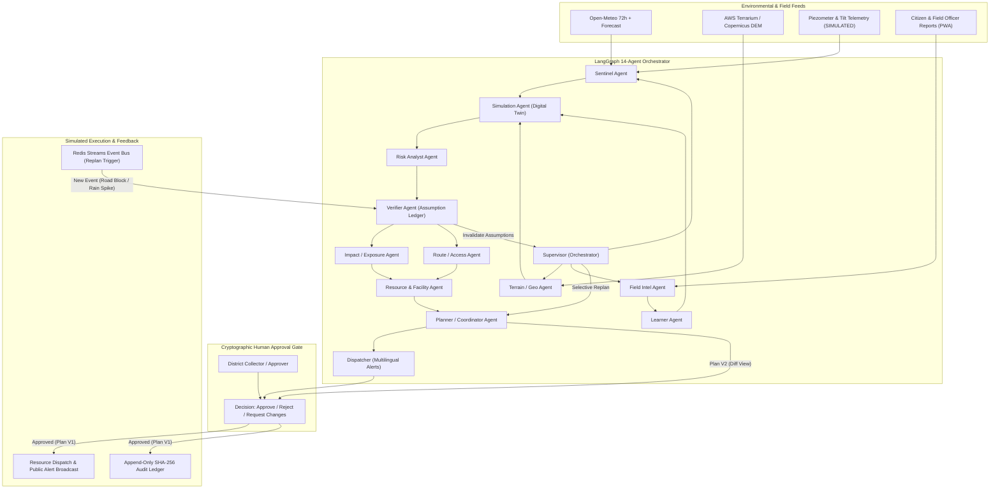

# System Architecture & Multi-Agent Specification

**Project:** RESQ.AI × BhuRaksha (National Landslide Framework)  
**Core Mission:** Agentic AI landslide intelligence, 3D digital-twin simulation, and dynamic response-coordination platform for India's North Eastern Region.

---

## 1. System Overview

---

## 2. Logical Agent Registry & Permissions

Each agent runs as an isolated execution node in the LangGraph runner with a strict tool allowlist and typed Pydantic input/output schemas:

| # | Agent ID | Name | Role & Objective | Permitted Tools (Allowlist) |
|---|---|---|---|---|
| 1 | `orchestrator` | **Supervisor (Orchestrator)** | Interprets triggers, creates DAG execution plans, manages iteration budgets, decides replanning scope. | `state.read`, `workflow.schedule` |
| 2 | `sentinel` | **Sentinel (Monitoring)** | Ingests rainfall, weather forecasts, soil moisture, and sensor telemetry; detects freshness and unit gaps. | `weather.get`, `sensor.latest`, `datasource.health` |
| 3 | `terrain` | **Terrain / Geo** | Retrieves DEM, derives slope, aspect, curvature, TWI, and queries assets in the AOI. | `terrain.features`, `gis.query` |
| 4 | `field_intel` | **Field Intel** | Triages citizen/field reports, extracts text/photos, detects duplicates, flags prompt injections. | `report.get`, `report.triage`, `report.dedupe` |
| 5 | `learner` | **Learner** | Calibrates soil parameters ($c'$, $\phi'$) from verified field reports; proposes model adjustments. | `sim.calibrate`, `feedback.log` |
| 6 | `simulation` | **Simulation (Digital Twin)** | Runs the physics-based landslide digital twin (hydrology → infinite-slope FS → D8 runout). | `sim.run` |
| 7 | `risk` | **Risk Analyst** | Fuses susceptibility, rainfall threshold, and physics FS via a deterministic scoring engine. | `risk.assess` |
| 8 | `verifier` | **Verifier** | Verifies evidence consistency, checks model limits, detects contradictions, manages the Assumption Ledger. | `evidence.check`, `assumptions.list`, `assumptions.invalidate` |
| 9 | `impact` | **Impact / Exposure** | Computes exposed settlements, roads, populations, shelters, and hospitals from the runout footprint. | `gis.exposure` |
| 10 | `route` | **Route / Access** | Finds evacuation and access routes around blocked and at-risk segments; marks `NO VERIFIED ROUTE` when blocked. | `route.compute` |
| 11 | `resource` | **Resource & Facility** | Matches response teams (NDRF/SDRF/BRO) and medical facilities to incident needs without double-booking. | `resource.query`, `resource.reserve` |
| 12 | `planner` | **Planner / Coordinator** | Builds versioned response plans ($V1, V2$) with dependencies, assumption links, and structural diffs. | `plan.create`, `plan.diff` |
| 13 | `dispatcher` | **Dispatcher (Comms)** | Drafts multilingual emergency alerts (EN, HI, AS, BN); enforces draft-only status until human approval. | `alert.draft`, `translate.draft` |
| 14 | `assistant` | **Ask Mission Control** | Natural-language Q&A interface grounded strictly in live database records and NDMA SOP citations. | `state.read`, `sop.search` |

---

## 3. Dynamic Re-Planning Engine & Assumption Ledger

### 3.1 The Dynamic Coordination Loop
The system operates on an event-driven coordination cycle:
$$\text{DETECT} \to \text{UNDERSTAND} \to \text{SIMULATE} \to \text{VERIFY} \to \text{PLAN} \to \text{APPROVE} \to \text{EXECUTE} \to \text{REPLAN}$$

### 3.2 Selective Re-Planning Rules
When a real-world perturbation occurs, only affected assumptions and downstream agent nodes are recomputed:

| Trigger Event Type | Invalidated Assumption Prefixes | Recomputed Agents | Carried-Over Agents (Preserved) |
|---|---|---|---|
| `RAIN_ESCALATION` | `A-RAIN` | `sentinel`, `simulation`, `risk`, `verifier`, `impact`, `route`, `resource`, `planner`, `dispatcher` | `terrain`, `field_intel` |
| `ROAD_BLOCKED` | `A-ROUTE` | `verifier`, `route`, `resource`, `planner`, `dispatcher` | `sentinel`, `terrain`, `simulation`, `risk`, `field_intel` |
| `FIELD_REPORT` (cracks) | `A-GROUND`, `A-SOIL` | `field_intel`, `learner`, `simulation`, `risk`, `verifier`, `impact`, `route`, `resource`, `planner`, `dispatcher` | `terrain` |
| `SENSOR_ANOMALY` | `A-SENSOR` | `sentinel`, `risk`, `verifier`, `planner`, `dispatcher` | `terrain`, `simulation`, `route` |
| `RESOURCE_FAILURE` | `A-RES` | `resource`, `planner` | All upstream agents |
| `API_OUTAGE` | `A-DATA` | `sentinel`, `verifier`, `planner` (switches to rule-based fallback) | Upstream physics results |

### 3.3 Plan Diff Generation
Every new plan version ($V_{k+1}$) produces a structural diff against $V_k$:
- **Added Tasks:** Tasks created to mitigate new exposure (e.g. secondary road closure).
- **Removed Tasks:** Obsolete tasks (e.g. routing over a now-blocked highway).
- **Changed Tasks:** Modified tasks (e.g. detour route updated, revised ETA).
- **Unchanged Tasks:** Tasks whose underlying assumptions remain valid (carried over without disruption).

---

## 4. Human-in-the-Loop Governance & Cryptographic Audit

### 4.1 Backend-Enforced Approval Gate
1. **Role Authorization:** Only authenticated users with role `approver` (e.g., District Collector) or `admin` can authorize a plan. Role `operator` is rejected with `403 Forbidden`.
2. **Version-Bound Decision:** An approval is strictly bound to `current_version`. Approving $V_1$ after $V_2$ has been generated fails with `409 Conflict`.
3. **Idempotence & Anti-Replay:** A plan can be decided only once. Duplicate approvals return `409 Conflict`.
4. **Automatic Alert Release:** Only upon an authenticated `approve` decision does the Dispatcher transition alerts from `PENDING_APPROVAL` to `DISPATCHED` (simulated gateway delivery).

### 4.2 Append-Only Hash-Chained Audit Ledger
Every action, tool call, assumption change, and approval is recorded in an immutable ledger where each block $i$ includes the cryptographic SHA-256 hash of block $i-1$:

$$H_i = \mathrm{SHA256}\left( H_{i-1} \,\|\, \mathrm{JSON}(\text{seq}_i, \text{ts}_i, \text{action}_i, \text{actor}_i, \text{data}_i) \right)$$

Endpoint `GET /api/audit/verify` audits the entire hash chain from `GENESIS` to ensure zero tampering.
